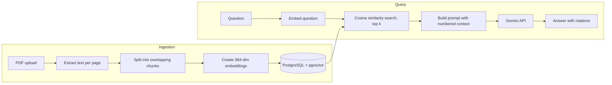

# RAG Document Chatbot

Ask questions about PDF documents and get answers **with page-level citations**.
Built with Python, PostgreSQL + pgvector, sentence-transformers, the Gemini API and Streamlit.
Runs entirely on free-tier services.

**[Live demo](<https://chaitanya-rag-bot.streamlit.app/>)** · 

> The live demo runs on free hosting and may take about a minute to wake up if it has been idle.


## What it does

- Upload a PDF (or use the sample documents) and ask questions in plain English
- Answers are generated **only from the document's content**, with numbered citations (file and page)
- Says *"I couldn't find that in the document"* instead of guessing
- Each visitor gets a private session: uploads are invisible to others and auto-deleted after 24 hours

## How it works



1. **Ingestion:** `pypdf` extracts text page by page. Text is split into ~1,000-character chunks with 150 characters of overlap, preferring sentence boundaries. Each chunk is embedded with `all-MiniLM-L6-v2` and stored with its page number.
2. **Retrieval:** the question is embedded and the closest chunks are found with a pgvector cosine-distance query (HNSW index).
3. **Generation:** the top chunks are placed in a prompt with strict rules (use only the context, cite sources, admit when the answer is missing) and sent to Gemini at low temperature.

## Tech stack

| Layer | Technology |
|---|---|
| Language | Python 3.12 |
| Embeddings | sentence-transformers (`all-MiniLM-L6-v2`, runs locally) |
| Vector store | PostgreSQL + pgvector (HNSW index) |
| LLM | Google Gemini API (free tier) |
| UI | Streamlit |
| API (optional) | FastAPI + Uvicorn |
| Hosting | Streamlit Community Cloud + Neon (free tiers) |
| Containers | Docker, Docker Compose |

## Design decisions

- **One database for everything.** Text, metadata and vectors live in PostgreSQL, so retrieval can use ordinary SQL (joins, filters, transactions) instead of a separate vector service.
- **Chunks never cross page boundaries**, so every citation points to an exact page.
- **Per-session isolation.** Each upload is stamped with a session ID and every search is filtered by it, alongside shared sample documents.
- **Guardrails for a public demo:** file-size, page-count and documents-per-session limits, a global storage cap, and automatic cleanup of old uploads.
- **Reliability:** transient Gemini errors (429/5xx) are retried with exponential backoff; users see friendly messages instead of stack traces.
- **Secrets** are kept out of the code (`.env` locally, the host's secrets store when deployed).
- **Hosting choice:** I evaluated free options at build time (Nov 2026). Hugging Face Spaces now requires a paid plan for Docker apps, so I chose Neon (free Postgres with pgvector) and Streamlit Community Cloud.

## Run it locally

**Option A: Docker Compose** (needs Docker Desktop)

```bash
cp .env.example .env        # add your GEMINI_API_KEY and GEMINI_MODEL
docker compose up --build
docker compose exec app python ingest.py data/your-sample.pdf
```

Open http://localhost:8501

**Option B: Python**

```bash
python -m venv .venv
.venv\Scripts\activate            # Windows (use source .venv/bin/activate on Mac/Linux)
pip install -r requirements.txt
cp .env.example .env              # fill in DATABASE_URL, GEMINI_API_KEY, GEMINI_MODEL
python ingest.py data/your-sample.pdf
python -m streamlit run streamlit_app.py
```

The optional FastAPI service (`pip install -r requirements-api.txt`, then `python -m uvicorn app.main:app --reload`) exposes `/health`, `/documents`, `/upload` and `/ask`; the matching UI is `streamlit_app_api.py`.

## Project structure

```
app/
  config.py          settings and demo limits
  pdf_reader.py      PDF text extraction
  chunker.py         overlapping chunking
  embedder.py        embedding model
  database.py        PostgreSQL + pgvector access
  ingest_service.py  ingestion pipeline with limits
  llm.py             prompt building and Gemini calls with retry
  rag.py             question -> answer pipeline
  main.py            FastAPI service
streamlit_app.py     hosted UI (direct mode, per-visitor sessions)
streamlit_app_api.py UI that talks to the FastAPI service
ingest.py, ask.py, search_docs.py   command-line tools
```

## Limitations and next steps

- Each question is answered independently (no conversation memory for follow-ups)
- Text-based PDFs only (scanned documents would need OCR)
- No re-ranking or hybrid keyword search yet
- Free-tier hosting sleeps when idle and shares one Gemini quota
- Approximate vector search combined with filters can return fewer results at large scale

## License

MIT